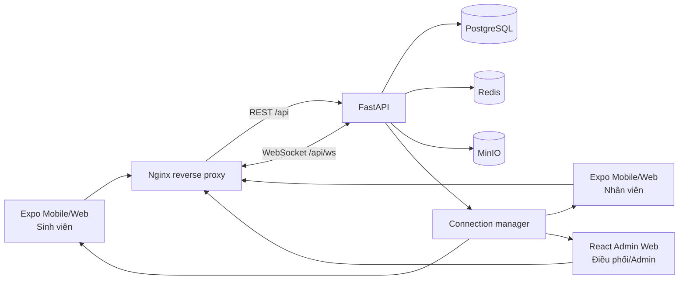
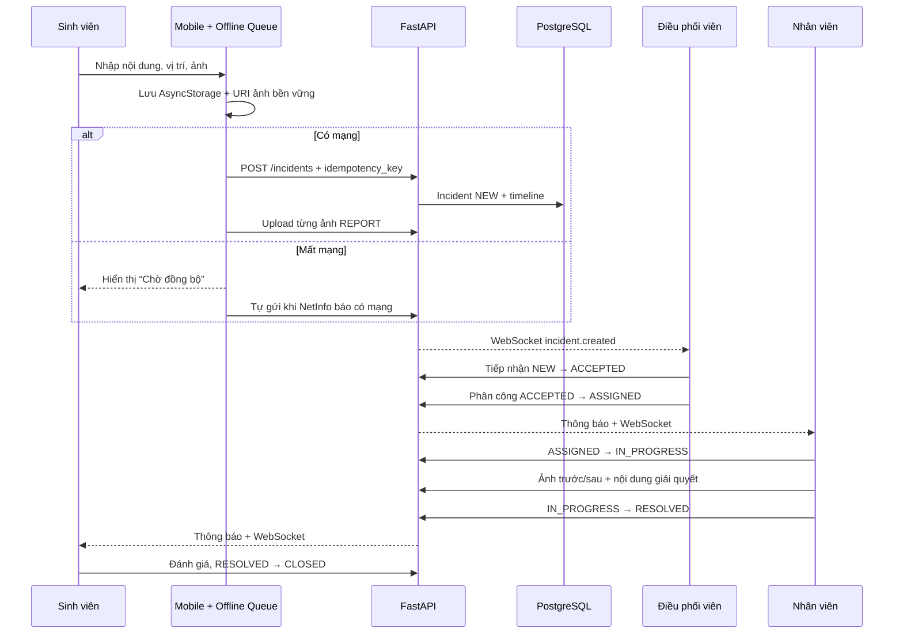

# Kiến trúc CampusCare

## Tổng quan

CampusCare dùng kiến trúc modular monolith cho API. Đây là điểm cân bằng phù hợp
với đồ án/MVP: transaction phân công và timeline nằm trong một CSDL, triển khai
đơn giản, nhưng router, service và adapter lưu trữ đã tách để có thể tách dịch vụ.

PostgreSQL, Redis và MinIO nằm trong Docker network `backend` có `internal: true`.
Chỉ Nginx cổng 80 được publish cho sản phẩm web. Mọi vai trò dùng chung
`http://localhost`; React dựa vào `role/account_type` do API trả về để hiển thị
giao diện phù hợp. Image `mobile-web` vẫn được build để kiểm chứng Expo Web nhưng
không publish thêm một cổng công khai.

## Luồng báo cáo sự cố

## Máy trạng thái

| Từ | Đến hợp lệ | Chủ thể chính |
|---|---|---|
| `NEW` | `ACCEPTED`, `REJECTED` | Dispatcher/Admin |
| `ACCEPTED` | `ASSIGNED`, `REJECTED` | Dispatcher/Admin |
| `ASSIGNED` | `IN_PROGRESS` | Nhân viên được giao |
| `IN_PROGRESS` | `RESOLVED` | Nhân viên được giao |
| `RESOLVED` | `CLOSED`, `IN_PROGRESS` | Sinh viên sở hữu/Dispatcher/Admin |
| `CLOSED`, `REJECTED` | Không có | Trạng thái cuối |

Mọi chuyển trạng thái đi qua `transition_incident`, kiểm tra cạnh hợp lệ và actor,
sau đó tạo `IncidentHistory` cùng transaction.

## Xác thực và phân quyền

- Access JWT sống ngắn; API kiểm tra user còn active ở mỗi request.
- Refresh JWT được lưu dạng SHA-256 digest, rotate khi dùng và có `revoked_at`.
- `require_roles` bảo vệ API quản trị; `assert_can_view` bảo vệ từng sự cố/ảnh.
- Không đưa mật khẩu/token vào audit details hoặc application log.

## Realtime và thông báo

Endpoint `/api/ws` nhận access token qua WebSocket subprotocol (không qua URL) và
xác thực trước khi accept. Sau commit,
API phát sự kiện `incident.created`, `incident.updated` hoặc
`notification.created`; TanStack Query invalidates cache tương ứng. Bản ghi
`notifications` là nguồn dữ liệu bền vững, nên mất kết nối WebSocket không làm mất
thông báo.

## Offline-first mobile

Payload có UUID sinh phía client. Queue lưu payload và URI ảnh trong AsyncStorage;
trên native ảnh cache được copy sang `documentDirectory/offline-reports`. Đồng bộ
luôn tạo sự cố trước với idempotency key, sau đó upload ảnh. Mục lỗi được giữ lại
với trạng thái `ERROR`, thông điệp lỗi và nút thử lại.

## Hướng phát triển

Redis-backed rate limiting/PubSub, push adapter, object lifecycle/thumbnail,
background sync native, SSO trường học, SLA calendar, full-text search, XLSX và
observability (OpenTelemetry/Prometheus) là các bước tiếp theo.
