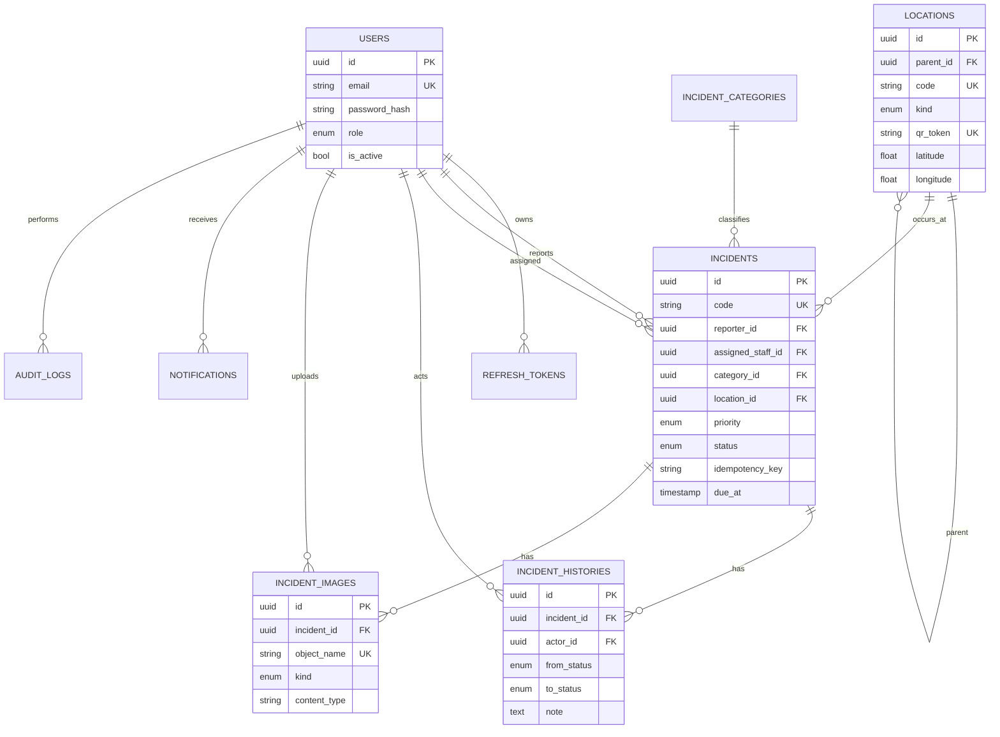

# Mô hình dữ liệu



## Bảng

- `users`: một role trên mỗi tài khoản, email unique, soft lock bằng `is_active`.
- `refresh_tokens`: chỉ giữ digest, thời hạn, thời điểm revoke và token thay thế.
- `locations`: adjacency list; code và QR token unique; khóa mềm.
- `incident_categories`: SLA phút và trạng thái hoạt động.
- `incidents`: snapshot nghiệp vụ hiện tại; unique `(reporter_id,
  idempotency_key)`; các timestamp phục vụ SLA/báo cáo.
- `incident_histories`: append-only timeline trạng thái và actor.
- `incident_images`: metadata/quyền trong PostgreSQL, binary trong MinIO.
- `notifications`: inbox bền vững, cờ đã đọc và JSON data.
- `audit_logs`: hành động nhạy cảm, entity, actor, IP và details an toàn.

## Migration và seed

Migration đầu tiên: `services/api/alembic/versions/0001_initial.py`. Container API
luôn chạy `alembic upgrade head` trước khi start. Seed idempotent nằm ở
`app/seed.py`; chạy lại không nhân đôi user/category/location/incident demo.

Backup tối thiểu:

```bash
docker compose exec postgres pg_dump -U campuscare -Fc campuscare > campuscare.dump
docker compose exec minio mc mirror /data /tmp/minio-backup
```

Khi production nên snapshot đồng thời PostgreSQL và MinIO để metadata/object nhất quán.

