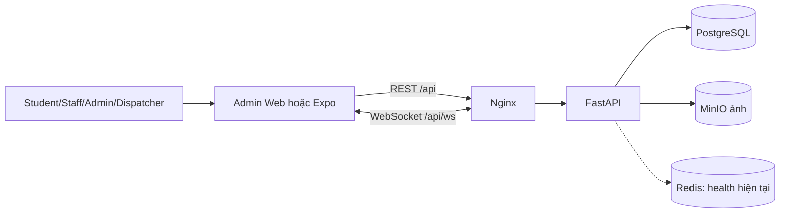

# Hướng dẫn CampusCare cho người mới hoàn toàn

Tài liệu này là giáo trình tra cứu. Trong cuộc trò chuyện, giảng viên vẫn dạy từng
bài và chờ người học trả lời; không cần đọc hết tài liệu trong một lần.

## Kết quả khảo sát ngày 24/08/2026

### Đã xác định bằng mã nguồn thật

| Nội dung cần biết | Kết quả |
|---|---|
| Backend khởi động | `services/api/app/main.py`, đối tượng `app`; Uvicorn dùng `app.main:app` |
| Admin Web khởi động | `apps/admin-web/index.html` → `src/main.tsx` → `src/App.tsx` |
| Mobile khởi động | package entry `expo-router/entry`; root layout `apps/mobile/app/_layout.tsx` |
| Compose chính | `compose.yaml` |
| Dockerfile | `services/api/Dockerfile`, `apps/admin-web/Dockerfile`, `apps/mobile/Dockerfile` |
| Database | PostgreSQL 17, service `postgres` |
| Volume DB theo cấu hình | named volume `postgres_data`, tên project thông thường `campuscare_postgres_data` |
| Ảnh sự cố | Bytes ở MinIO `minio_data`; metadata ở table `incident_images` |
| URL API admin | `apps/admin-web/src/api.ts`: `VITE_API_URL` hoặc `/api` |
| URL API mobile | `apps/mobile/src/api.ts`: `EXPO_PUBLIC_API_URL`; web fallback `/api` |
| Route admin | `apps/admin-web/src/App.tsx` |
| Route mobile | File-based routes trong `apps/mobile/app` và các `_layout.tsx` |
| Route backend | `services/api/app/main.py` gắn router từ `app/api/*.py` |
| Model | `services/api/app/models.py` |
| Migration | `services/api/alembic/versions/0001_initial.py` |
| Luồng login | `LoginPage/LoginScreen.submit` → AuthProvider → `api` → `auth.login` → `users`/`refresh_tokens` |
| Luồng tạo incident | `ReportScreen.submit` → queue → `sendQueuedReport` → `create_incident` → PostgreSQL → WebSocket |
| Git history | **Không có**; repository không phải Git worktree |

### Trạng thái kiểm tra thực tế

- `docker compose config --quiet`: đạt.
- Docker Desktop Engine: **không chạy trong lần khảo sát này**; vì vậy trạng thái
  container, health runtime, volume runtime, bảng DB đang chạy và log hiện tại là
  **chưa xác định**. Không dùng số liệu cũ để đoán.
- Admin/mobile TypeScript: đạt.
- Admin: 2 file/4 test đạt; ESLint đạt.
- Mobile: 3 file/7 test đạt.
- Backend Ruff/Pytest lần này: chưa chạy vì Docker tắt và host không có Python.

Không có mã nguồn sản phẩm nào được sửa trong đợt khảo sát; chỉ ba tài liệu người
mới trong `docs/` được tạo.

---

# Bài 0: Bức tranh tổng thể

## 1. Mục tiêu

Hiểu CampusCare dùng để làm gì, phân biệt frontend/backend/API/database và biết
Docker, Nginx, PostgreSQL, Redis, MinIO kết nối ra sao.

## 2. Giải thích đơn giản và ví dụ trường học

CampusCare nhận sự cố từ Student, giúp Dispatcher tiếp nhận/phân công, Staff xử
lý và Admin quản trị. Hãy hình dung:

| Thành phần | Nó là gì? | Ví dụ đời sống | Nằm ở đâu? | Hoạt động/kết nối | Muốn đổi và kiểm tra | Lỗi thường gặp |
|---|---|---|---|---|---|---|
| Admin Web | Frontend quản trị React | Quầy điều phối | `apps/admin-web` | Browser gọi `/api`, nghe `/api/ws` | Sửa `src/*`; typecheck/test/build | Trang trắng, lỗi JS/API |
| Mobile | Expo app Student/Staff | Quầy di động | `apps/mobile` | Web/Expo Go gọi API | Sửa `app/*`,`src/*`; typecheck/test/export | Sai URL, quyền camera/GPS |
| Backend | FastAPI xử lý nghiệp vụ | Nhân viên sau quầy | `services/api/app` | Nhận API, đọc DB/MinIO, phát WS | Sửa router/service/schema/model; Ruff/Pytest | 401/403/422/500 |
| API | Hợp đồng HTTP, không phải container riêng | Mẫu phiếu trao đổi | `app/api/*.py`, `schemas.py` | Frontend gửi JSON/multipart | Sửa endpoint/schema/types; Swagger/tests | Sai URL/payload/status |
| PostgreSQL | Kho record chính | Kho hồ sơ | service `postgres`, `models.py` | Backend dùng SQLAlchemy | Model + migration mới; Pytest/Alembic | Connection/schema lỗi |
| Redis | Kho key-value nhanh | Bảng ghi nhớ | service `redis` | Hiện code chỉ PING trong health | Khi tích hợp cache/pubsub; test health | Redis unavailable; hiện 0 nghiệp vụ phụ thuộc trực tiếp |
| MinIO | Object storage ảnh | Kho ảnh | service `minio`, `storage.py` | API ghi/đọc bytes | Storage/router; upload/download test | Bucket/credential/MIME lỗi |
| Nginx | Reverse proxy | Lễ tân | `infrastructure/nginx/nginx.conf` | `/` → admin; `/api`/WS → API | Sửa config; config/health/smoke | 502, WS disconnect |
| Docker | Đóng gói môi trường | Các phòng làm việc riêng | Dockerfiles + Compose | Chạy 7 service/network/volume | Sửa Compose/Dockerfile; config/build/health | Engine off, port conflict, unhealthy |

## 3. Bằng chứng và sơ đồ



Compose khai báo đúng 7 service: `postgres`, `redis`, `minio`, `api`,
`admin-web`, `mobile-web`, `nginx`. Chi tiết sơ đồ ở `docs/LUONG_HOAT_DONG.md`.

## 4. File nên mở trong IDE

`compose.yaml`, `infrastructure/nginx/nginx.conf`, `services/api/app/main.py`,
`apps/admin-web/src/main.tsx`, `apps/admin-web/src/App.tsx`,
`apps/mobile/app/_layout.tsx`.

## 5. Thực hành quan sát

Chưa sửa gì. Tìm bảy tên service trong `compose.yaml`, rồi tìm `/api` trong config
Nginx để thấy “lễ tân” chuyển yêu cầu.

## 6. Ba câu hỏi

1. Frontend có được tự sửa PostgreSQL trực tiếp không? Vì sao?
2. Bytes ảnh nằm chủ yếu trong PostgreSQL hay MinIO?
3. API là một container riêng hay là giao diện do FastAPI cung cấp?

## 7. Năm ý cần nhớ

1. Frontend hiển thị; backend quyết định nghiệp vụ/quyền.
2. API là hợp đồng giao tiếp.
3. PostgreSQL giữ record; MinIO giữ bytes ảnh.
4. Nginx điều hướng REST/WebSocket.
5. Docker chạy các thành phần; volume giữ dữ liệu.

---

# Bài 1: Dự án được tạo ra từ đâu?

## 1. Mục tiêu

Hiểu trình tự hợp lý để xây hệ thống từ số 0 và biết sản phẩm của từng bước nằm ở
đâu. Không bịa trình tự Git.

## 2. Giải thích và ví dụ đời sống

Xây phần mềm giống xây trường: hiểu nhu cầu → vẽ mặt bằng → xây kho/nghiệp vụ →
làm quầy → nối điện/nước → kiểm định.

| Bước hợp lý | Sản phẩm hiện có |
|---|---|
| 1. Xác định bài toán | `README.md`, `PLAN.md`, `docs/ARCHITECTURE.md` |
| 2. Vai trò/chức năng | `app/enums.py:Role`, router, `App.tsx`, mobile tabs |
| 3. Thiết kế DB | `app/models.py`, `docs/DATABASE.md` |
| 4. Backend nghiệp vụ | `app/services.py`, `dependencies.py`, `security.py` |
| 5. API | `app/api/*.py`, `schemas.py`, Swagger |
| 6. Website | `apps/admin-web/src` |
| 7. Mobile | `apps/mobile/app`, `apps/mobile/src` |
| 8. Kết nối | hai `api.ts`, Nginx config, WebSocket |
| 9. Docker | ba Dockerfile, hai Compose file |
| 10. Test/deploy | `tests`, frontend tests, `scripts`, `docs/DEPLOYMENT.md` |

## 3. Bằng chứng thực tế

Không có `.git` worktree/commit history. Do đó chỉ có thể trình bày trình tự hợp
lý ở trên; **trình tự phát triển thực tế trong Git: chưa xác định**.

## 4. File nên mở

`PLAN.md`, `README.md`, `app/models.py`, `app/services.py`, `App.tsx`, mobile
`_layout.tsx`, `compose.yaml`.

## 5. Thực hành

Vẽ mười ô bước trên giấy và ghi một file thật dưới mỗi ô.

## 6. Ba câu hỏi

1. Vì sao nên thiết kế dữ liệu trước form chi tiết?
2. API nên xây trước hay sau khi đã hiểu chức năng?
3. Ta có biết commit nào được tạo trước không?

## 7. Năm ý

1. Bắt đầu từ bài toán, không từ nút bấm.
2. Role và dữ liệu quyết định nhiều lớp sau.
3. Backend/API là nền cho hai frontend.
4. Docker đóng gói sau khi biết thành phần cần chạy.
5. Không có Git history thì phải nói không xác định.

---

# Bài 2: Ngôn ngữ và cú pháp căn bản

## 1. Mục tiêu

Nhận diện Python, TypeScript/React, YAML và SQL xuất hiện thật trong dự án.

## 2. Python

Đoạn thật ở `services/api/app/main.py`, hàm `live`:

```python
@api.get("/live", tags=["Hệ thống"])
def live():
    return {"status": "ok"}
```

- `@api.get(...)`: decorator đăng ký URL GET `/api/live` (router `api` có prefix
  `/api`).
- `def live():`: định nghĩa hàm tên `live`.
- Dòng `return` thụt vào bốn khoảng trắng vì thuộc thân hàm.
- `{...}` là dictionary; FastAPI đổi thành JSON.

Đoạn async thật trong cùng file:

```python
@app.websocket("/api/ws")
async def websocket_endpoint(websocket: WebSocket):
    await websocket.send_json({"event": "connected"})
```

- `async def`: hàm có thể chờ I/O mà không khóa toàn bộ server.
- `websocket: WebSocket`: tham số có type hint.
- `await`: chờ thao tác gửi dữ liệu bất đồng bộ.

Các khái niệm còn lại:

- `import`: mang class/hàm từ module khác vào; xem đầu `main.py`.
- Biến: `settings = get_settings()` giữ một giá trị.
- `class`: khuôn tạo đối tượng; ví dụ `User` trong `models.py`.
- Kiểu dữ liệu: `str`, `int`, `uuid.UUID`, `User | None`, `list[...]`.
- Sai thụt lề Python thường gây `IndentationError` ngay khi khởi động.

## 3. TypeScript/React

Đoạn thật ở `apps/mobile/app/index.tsx`, component `Index`:

```tsx
export default function Index() {
  const { user, ready } = useAuth();
  if (!ready) return <ActivityIndicator />;
  return <Redirect href={user ? (user.role === 'STAFF' ? '/tasks' : '/home') : '/login'} />;
}
```

- `export default`: cho file khác/Expo Router dùng component chính.
- `function Index`: component React là hàm trả giao diện.
- `const`: khai báo biến không gán lại.
- `useAuth()`: hook đọc state đăng nhập.
- JSX/TSX là cú pháp giống HTML nằm trong TypeScript.
- Biểu thức `{...}` đưa logic JavaScript vào JSX.

Trong dự án:

- `props`: dữ liệu cha truyền con, ví dụ `Loading({ label })` ở `States.tsx`.
- `state`: `useState` ở `LoginPage.tsx` giữ email/loading/error.
- `useEffect`: `Layout.tsx` mở WebSocket sau render và đóng khi unmount.
- gọi API: `api<Incident[]>('/incidents')`.
- event: `onClick`, `onChange`, `onPress`, `onSubmit`.
- Sai type → `tsc --noEmit`; sai runtime → console/browser/Expo log.

## 4. YAML

Đoạn thật rút từ `compose.yaml`:

```yaml
services:
  postgres:
    image: postgres:17-alpine
    volumes:
      - postgres_data:/var/lib/postgresql/data
```

- YAML dùng thụt lề để biểu diễn cha/con; không dùng tab tùy tiện.
- `services`: nhóm container.
- `image`: image có sẵn.
- `build`: tự xây từ Dockerfile (api/admin/mobile).
- `ports`: ánh xạ `host:container`.
- `environment`: biến cấu hình trong container.
- `depends_on`: thứ tự phụ thuộc/health.
- `volumes`: gắn storage bền vững.
- `healthcheck`: lệnh Docker dùng để đánh giá healthy.

## 5. SQL/database

- Database: kho dữ liệu PostgreSQL `campuscare` theo giá trị mặc định cấu hình.
- Table: nhóm record cùng cấu trúc, ví dụ `incidents`.
- Column: thuộc tính, ví dụ `status`.
- Row: một sự cố cụ thể.
- Primary key: `id` duy nhất.
- Foreign key: `reporter_id` trỏ `users.id`.
- Một-nhiều: một incident có nhiều `incident_histories`.
- Migration: file phiên bản thay đổi schema.

## 6. Ví dụ đời sống

Class là mẫu phiếu; object/row là phiếu đã điền. Type là quy định ô “ngày” không
được điền chữ tùy ý. Migration là biên bản thay đổi mẫu tủ hồ sơ.

## 7. File nên mở

`app/main.py`, `app/models.py`, `admin/components/States.tsx`,
`mobile/app/index.tsx`, `compose.yaml`, migration `0001_initial.py`.

## 8. Thực hành

Chỉ đọc: tìm một `class`, một `async def`, một `useState`, một `onClick`, một
`healthcheck` và một foreign key.

## 9. Ba câu hỏi

1. Vì sao dòng trong thân hàm Python phải thụt vào?
2. Component React trả về cái gì?
3. `reporter_id` nối hai bảng nào?

## 10. Năm ý

1. Python chạy backend.
2. TypeScript/React tạo UI và kiểm type sớm.
3. JSX là giao diện trong code TypeScript.
4. YAML mô tả hạ tầng bằng thụt lề.
5. SQL/table/foreign key tổ chức dữ liệu liên quan.

---

# Bài 3: Docker hoạt động như thế nào?

## 1. Mục tiêu

Phân biệt Docker Desktop, image, container, Dockerfile, Compose, volume, network,
port, environment và Nginx trên đúng cấu hình CampusCare.

## 2. Khái niệm theo tám câu hỏi

| Khái niệm | Là gì/ví dụ | Ở đâu | Khi hoạt động/kết nối | Sửa ở đâu | Kiểm tra | Lỗi thường gặp |
|---|---|---|---|---|---|---|
| Docker Desktop | Ứng dụng quản lý Docker Engine; tòa nhà vận hành | Windows | Trước mọi lệnh Docker | Settings Docker, không phải code | `docker version` | Engine/pipe not found |
| Image | Gói read-only; bản thiết kế phòng | Images Docker | Trước khi tạo container | Dockerfile/tag Compose | `docker images`/build | Build dependency lỗi |
| Container | Instance đang chạy của image; phòng đang làm việc | `docker compose ps` | Sau `up` | Config/image rồi recreate | `ps`, logs, health | exited/unhealthy |
| Dockerfile | Công thức build image | ba Dockerfile | `compose build/up --build` | Các bước FROM/COPY/RUN/CMD | build riêng service | COPY/path/command lỗi |
| Compose | Sơ đồ nhiều service | hai compose file | `docker compose ...` | service/network/volume/port | `config --quiet` | YAML/env/port lỗi |
| Volume | Storage độc lập vòng đời container | cuối `compose.yaml` | Mount vào service | mapping/backup policy | `docker volume ls/inspect` | xóa volume mất dữ liệu |
| Network | Hành lang DNS nội bộ | `backend`, `frontend` | Container gọi nhau bằng service name | Compose networks | inspect/connectivity | name resolution/refused |
| Port | Cửa số; host:container | `80:80` | Client ngoài Docker truy cập | Compose ports | `ps`, request URL | port already in use |
| Environment | Cấu hình, không phải dữ liệu | `.env`, Compose, `config.py`, client env | Startup/build | `.env`/deployment secret | Compose config/health | sai URL/credential/CORS |
| Nginx | Reverse proxy; lễ tân | Nginx configs | Mọi request web | config | health/REST/WS | 502/route/WS lỗi |

## 3. Từng service thật

| Service | Image/build | Port host → container | Phụ thuộc | Volume | Health |
|---|---|---|---|---|---|
| `postgres` | `postgres:17-alpine` | không publish; nội bộ 5432 | không | `postgres_data:/var/lib/postgresql/data` | `pg_isready` |
| `redis` | `redis:8-alpine`, AOF | không publish; 6379 | không | `redis_data:/data` | `redis-cli ping` |
| `minio` | image MinIO được pin | không publish; 9000 | không | `minio_data:/data` | MinIO live URL |
| `api` | `services/api/Dockerfile` | không publish; 8000 | 3 service dữ liệu healthy | `qr_data:/app/generated_qr` | `/api/health` |
| `admin-web` | `apps/admin-web/Dockerfile` | nội bộ 80 | API healthy | không | Dockerfile `/healthz` |
| `mobile-web` | `apps/mobile/Dockerfile` | không publish; nội bộ 80 | API healthy | không | Dockerfile `/healthz` |
| `nginx` | `nginx:1.28-alpine` | `80 → 80` | API + admin healthy | bind mount config read-only | `/healthz` |

## 4. `up --build -d` xảy ra gì?

Compose đọc YAML/env → build ba image → tạo/gắn network và volume → start ba kho
dữ liệu → chờ health → API chạy migration, seed, Uvicorn → start hai static web →
start gateway. `-d` chạy nền; `--build` cập nhật image.

## 5. Phân biệt bắt buộc

- Mã nguồn: file ở `D:\viusal\DUAN`.
- Image: môi trường đã đóng gói.
- Container: process đang chạy từ image.
- Record DB: trong named volume PostgreSQL.
- Bytes ảnh: MinIO volume.
- `.env`: cấu hình; không chứa table/row/ảnh.
- Stop/restart không tự xóa volume.
- Xóa volume có thể mất dữ liệu.

## 6. Bằng chứng/runtime

`docker compose config --quiet` đạt ngày 24/08. Docker Engine đang tắt nên
container/health hiện tại chưa xác định; thông báo pipe `dockerDesktopLinuxEngine`
không tồn tại chính là dấu hiệu Engine chưa chạy.

## 7. File nên mở và thực hành

Mở `compose.yaml` từ trên xuống, ba Dockerfile, ba Nginx config. Thực hành chỉ đọc:
đánh dấu service nào build, service nào dùng image có sẵn, service nào có volume.

## 8. Ba câu hỏi

1. Image và container khác nhau thế nào?
2. Tại sao build lại API không đồng nghĩa xóa PostgreSQL?
3. Vì sao `mobile-web` vẫn được build nhưng không publish thêm cổng?

## 9. Năm ý

1. Docker Desktop phải có Engine running.
2. Dockerfile tạo image; image tạo container.
3. Compose điều phối nhiều container.
4. Named volume tách dữ liệu khỏi container.
5. Chỉ Nginx cổng 80 được publish; bốn vai trò dùng chung một cổng web.

---

# Bài 4: Database được lưu ở đâu?

## 1. Mục tiêu

Biết chính xác record, ảnh, cache, token và config nằm ở đâu; biết xem/backup an
toàn mà không xóa dữ liệu.

## 2. Mười tám câu trả lời chính xác

1. PostgreSQL 17.
2. Service `postgres`.
3. Giá trị mặc định `POSTGRES_DB` là `campuscare`; runtime hôm nay chưa xác nhận
   do Engine tắt.
4. Chín bảng nghiệp vụ theo model: `users`, `refresh_tokens`, `locations`,
   `incident_categories`, `incidents`, `incident_histories`, `incident_images`,
   `notifications`, `audit_logs`; khi Alembic chạy còn `alembic_version`.
5. Tất cả model ở `services/api/app/models.py`.
6. Migration tạo schema: `services/api/alembic/versions/0001_initial.py`.
7. Seed: `services/api/app/seed.py`.
8. Compose volume `postgres_data`; project name `campuscare` thường tạo
   `campuscare_postgres_data`, nhưng runtime hôm nay chưa inspect được.
9. Đây là named volume, không phải bind mount.
10. Trên Docker Desktop Windows, dữ liệu nằm trong Linux VM/storage Docker, không
    thành thư mục PostgreSQL dễ thấy trong project.
11. Stop/restart container vẫn còn nếu volume còn.
12. Build lại backend không xóa volume DB.
13. `docker compose down -v`, `docker volume rm`, Docker Desktop factory reset,
    hoặc SQL `DROP/DELETE` có nguy cơ mất dữ liệu. Không chạy chỉ để thử.
14. Dùng `psql` với `\dt`, `\d incidents`, và chỉ `SELECT ... LIMIT ...`.
15. Backup bằng `pg_dump`; restore trước vào database kiểm tra riêng. Backup cả
    PostgreSQL và MinIO để metadata/bytes nhất quán.
16. Bytes ảnh trong MinIO `minio_data`.
17. PostgreSQL table `incident_images` giữ object name, MIME, size, kind; không giữ
    bytes ảnh.
18. Redis hiện chưa chứa dữ liệu nghiệp vụ chính; code chỉ PING cho health. AOF và
    volume đã cấu hình để sẵn sàng cho use case tương lai.

## 3. Bảng nơi lưu

| Loại dữ liệu | Nơi lưu thật | Định nghĩa ở đâu | Mất khi restart? |
|---|---|---|---|
| Tài khoản | PostgreSQL `users` | `models.py:User` | Không nếu volume còn |
| Sự cố | PostgreSQL `incidents` | `models.py:Incident` | Không |
| Địa điểm | PostgreSQL `locations` | `models.py:Location` | Không |
| Phân công hiện tại | `incidents.assigned_staff_id` | `models.py:Incident` | Không |
| Timeline | `incident_histories` | `models.py:IncidentHistory` | Không |
| Notification | `notifications` | `models.py:Notification` | Không |
| Metadata ảnh | `incident_images` | `models.py:IncidentImage` | Không |
| Bytes ảnh | MinIO named volume | `storage.py:ObjectStorage` | Không nếu volume còn |
| Cache/PubSub | Chưa dùng nghiệp vụ; Redis có service/volume | Compose/main health | N/A hiện tại |
| Refresh token | Hash trong PostgreSQL `refresh_tokens` | model/auth/security | Không |
| Access token web | Browser localStorage | `admin/src/api.ts` | Còn qua refresh browser, mất khi clear storage |
| Session mobile | AsyncStorage thiết bị | `mobile/src/api.ts` | Còn qua restart app, mất khi clear app data |
| Offline reports | AsyncStorage + file documentDirectory | mobile queue files | Còn qua restart, không qua uninstall/clear data |
| Cấu hình | `.env`/environment | `.env.example`, Compose, config files | Không phải record DB |
| QR seed | `qr_data` | `seed.py`, Compose | Không nếu volume còn |

## 4. Lệnh xem chỉ đọc (root `D:\viusal\DUAN`)

```powershell
docker compose exec -T postgres sh -c 'psql -U "$POSTGRES_USER" -d "$POSTGRES_DB" -c "\dt"'
docker compose exec -T postgres sh -c 'psql -U "$POSTGRES_USER" -d "$POSTGRES_DB" -c "\d incidents"'
docker compose exec -T postgres sh -c 'psql -U "$POSTGRES_USER" -d "$POSTGRES_DB" -c "SELECT id, code, title, status FROM incidents ORDER BY created_at DESC LIMIT 10;"'
```

Các lệnh chỉ chọn/miêu tả. Không gõ `DELETE`, `DROP`, `TRUNCATE`, `UPDATE` khi chỉ
muốn quan sát.

## 5. Backup/restore an toàn

Backup không đưa password vào command:

```powershell
New-Item -ItemType Directory -Force .\backups
docker compose exec -T postgres sh -c 'pg_dump -U "$POSTGRES_USER" -d "$POSTGRES_DB" -Fc -f /tmp/campuscare.dump'
docker compose cp postgres:/tmp/campuscare.dump .\backups\campuscare.dump
```

Kiểm tra restore vào DB riêng, không ghi đè DB chính:

```powershell
docker compose cp .\backups\campuscare.dump postgres:/tmp/campuscare.dump
docker compose exec -T postgres sh -c 'createdb -U "$POSTGRES_USER" campuscare_restore_check'
docker compose exec -T postgres sh -c 'pg_restore -U "$POSTGRES_USER" -d campuscare_restore_check /tmp/campuscare.dump'
```

Nếu DB kiểm tra đã tồn tại, dừng và chọn tên mới; đừng tự xóa. Khôi phục đè DB
production là thao tác phá hủy, cần backup mới nhất và kế hoạch downtime riêng.

## 6. Ví dụ đời sống

Model là bản thiết kế tủ; migration là biên bản đóng/tân trang tủ; row là hồ sơ;
volume là nhà kho; MinIO là kho ảnh có mã object khớp sổ trong PostgreSQL.

## 7. File nên mở và thực hành

Mở `models.py`, migration, `seed.py`, `storage.py`, phần volumes trong Compose.
Thực hành: viết ra giấy nơi lưu của incident, image bytes và refresh token.

## 8. Ba câu hỏi

1. PostgreSQL lưu bytes ảnh hay metadata ảnh?
2. Tắt container có xóa named volume không?
3. Vì sao nên restore thử sang DB khác?

## 9. Năm ý

1. PostgreSQL là nguồn record chính.
2. MinIO giữ bytes ảnh.
3. Named volume do Docker quản lý ngoài thư mục source.
4. Refresh token được lưu dạng hash trong DB.
5. Backup và restore thử trước mọi thao tác production.

---

# Bài 5: Giao diện website nằm ở đâu?

## 1. Mục tiêu

Biết điểm vào React, router, pages, components, API/auth/WS/theme và trình tự render.

## 2. Giải thích và bằng chứng

- HTML vào: `apps/admin-web/index.html`.
- React vào: `src/main.tsx`.
- Router: `src/App.tsx`.
- Pages: `src/pages`.
- Components dùng chung: `src/components`.
- Login/Dashboard/List/Map: `LoginPage.tsx`, `DashboardPage.tsx`,
  `IncidentsPage.tsx`, `MapPage.tsx`.
- Theme: `src/styles.css`.
- URL/request/session/WS URL: `src/api.ts`.
- Auth state: `src/auth.tsx`.
- WebSocket listener: `src/components/Layout.tsx`.
- Logo: không có asset ảnh riêng; icon `Activity` từ Lucide.

Bảng route/API đầy đủ ở `docs/BAN_DO_MA_NGUON.md`.

## 3. Từ URL đến dữ liệu

Nginx trả `index.html` → browser nạp `main.tsx` → providers dựng `App` → Router
chọn page → `Guard` kiểm session UI → page dùng TanStack Query → `api.ts` gắn JWT
→ Nginx `/api` → FastAPI → JSON → Query state → React render.

## 4. Ví dụ đời sống

`index.html` là cửa tòa nhà; `main.tsx` bật điện; `App.tsx` là bảng chỉ đường;
page là từng phòng; `api.ts` là nhân viên giao phiếu.

## 5. File nên mở

`index.html`, `main.tsx`, `App.tsx`, `Layout.tsx`, một page, `api.ts`, `auth.tsx`,
`styles.css`.

## 6. Thực hành

Không sửa: chọn route `/map`, lần theo `App.tsx` → `MapPage.tsx` → API được gọi.

## 7. Ba câu hỏi

1. File nào quyết định `/incidents` dùng page nào?
2. Session admin nằm ở đâu?
3. Ẩn menu có đủ bảo mật không?

## 8. Năm ý

1. `main.tsx` khởi động React.
2. `App.tsx` ánh xạ URL → page.
3. TanStack Query giữ trạng thái dữ liệu server.
4. `api.ts` tập trung transport/session refresh.
5. Backend RBAC vẫn bắt buộc dù frontend có Guard.

---

# Bài 6: Ứng dụng mobile nằm ở đâu?

## 1. Mục tiêu

Hiểu Expo Router, screen/layout, API/auth, camera/GPS/QR, offline queue và ba cách
chạy mobile.

## 2. Giải thích và bằng chứng

- Entry package: `expo-router/entry` trong `apps/mobile/package.json`.
- Root layout: `app/_layout.tsx`; tab layout: `app/(tabs)/_layout.tsx`.
- File trong `app` tự trở thành route; `(tabs)` là route group.
- API/auth: `src/api.ts`, `src/AuthContext.tsx`.
- API URL: `EXPO_PUBLIC_API_URL`; web fallback `/api`, native fallback trong code
  là localhost nhưng điện thoại thật phải override bằng IP LAN.
- Chụp/chọn ảnh: `report.tsx`, `task.tsx` dùng Expo ImagePicker.
- GPS: `select-location.tsx` dùng Expo Location.
- QR: `scan.tsx` dùng `CameraView`.
- Queue: `offlineQueue.ts`; network/copy/sync: `queueRuntime.ts`; NetInfo watcher
  được bật trong root layout.

## 3. Ba dạng chạy

| Dạng | Chạy ở đâu | Backend |
|---|---|---|
| Expo Web | Browser bằng dev server hoặc static `mobile-web` | Gọi `/api` qua proxy |
| Expo Go | App Expo Go trên điện thoại | Gọi IP LAN laptop/Internet |
| APK/AAB | Android app đã đóng gói bằng EAS | Gọi URL build-time/deploy |

Docker chỉ chạy backend và bản **web** tĩnh; không chạy Android app. Trên điện
thoại, `localhost` là điện thoại. Tìm IP laptop bằng `ipconfig`, chọn IPv4 của Wi-Fi
đang cùng mạng và đặt `EXPO_PUBLIC_API_URL=http://<IP-LAN>/api`.

## 4. Ví dụ đời sống

Expo Router giống tòa nhà lấy tên phòng từ tên file. AsyncStorage là ngăn kéo trên
thiết bị; NetInfo là người quan sát mạng; `runSync` là người chuyển phiếu chờ.

## 5. File nên mở

`package.json`, `app.json`, `eas.json`, hai layout, `report.tsx`, `scan.tsx`,
`select-location.tsx`, `src/api.ts`, ba file queue/realtime.

## 6. Thực hành

Không sửa: lấy route `/scan`, chỉ ra file, thư viện camera, API resolve QR và route
đích sau khi quét thành công.

## 7. Ba câu hỏi

1. Vì sao Docker không phải nơi chạy APK?
2. Vì sao điện thoại không dùng localhost để gọi laptop?
3. Payload offline và ảnh native được giữ ở đâu?

## 8. Năm ý

1. Expo Router dùng cấu trúc file.
2. Root layout dựng auth, network watcher và realtime.
3. AsyncStorage giữ session/queue.
4. Ảnh offline native được copy vào document directory.
5. Expo Go cần URL IP LAN truy cập được.

---

# Bài 7: Backend nằm ở đâu?

## 1. Mục tiêu

Phân biệt router, schema, model, service, dependency, authentication, RBAC,
migration, seed, WebSocket, storage, error handling và test trong backend thật.

## 2. Kiến trúc thực tế

| Lớp | Nhiệm vụ | File thật | Không nên đặt gì ở đây? |
|---|---|---|---|
| App entry | Tạo FastAPI, CORS, router, health, WS, handler 500 | `app/main.py` | Toàn bộ CRUD/JSX |
| Router/controller | Nhận HTTP, dependency, commit, response | `app/api/*.py` | Lặp state machine/hash |
| Schema/Pydantic | Validate request/response/OpenAPI | `app/schemas.py` | SQL query/UI |
| Model/SQLAlchemy | Bảng/cột/quan hệ | `app/models.py` | HTTP response/React |
| Service | Quy tắc trạng thái/ownership/audit/notification/SLA | `app/services.py` | Request parsing/UI |
| Repository | Không có layer riêng | Router query SQLAlchemy trực tiếp | Không giả định file tồn tại |
| Dependency | Current user/RBAC/rate limit/IP | `app/dependencies.py` | Nghiệp vụ dài |
| Authentication | Hash/JWT/refresh rotation | `security.py`, `api/auth.py` | Log password/token |
| Authorization | `require_roles`, `assert_can_view`, transition actor checks | dependencies/services/routers | Chỉ ẩn nút frontend |
| Migration | Version schema | `alembic/env.py`, `alembic/versions` | Seed/change migration cũ |
| Seed | Dữ liệu demo idempotent và QR | `app/seed.py` | Thay thế migration |
| WebSocket | Xác thực socket và quản lý connection in-memory | `main.py`, `realtime.py` | Nguồn dữ liệu bền vững |
| Upload | RBAC/MIME/size/Pillow + MinIO | `api/incidents.py`, `storage.py` | Tin filename/MIME client |
| Logging/audit | Uvicorn access log + `audit_logs` nghiệp vụ | runtime + `services.py:audit` | Secret/token/password |
| Error handling | HTTPException/Pydantic + handler 500 chung | routers/main.py | Stack trace ra client |
| Tests | SQLite in-memory và TestClient | `services/api/tests` | Phụ thuộc dữ liệu production |

## 3. Sáu khái niệm dễ nhầm

- Router: cửa nhận request.
- Service: luật nghiệp vụ dùng lại.
- Schema: hình dạng dữ liệu đi qua cửa.
- Model: bản đồ Python của table.
- Migration: phiên bản thay đổi cấu trúc table.
- Database record: một row thật được lưu sau khi app chạy.

Ví dụ đời sống: router là quầy; schema là mẫu phiếu; service là nội quy; model là
sơ đồ tủ; migration là lệnh đóng thêm ngăn; record là hồ sơ thật.

## 4. Bằng chứng

`main.py` gắn tám router. `incidents.py:update_status` gọi
`services.py:transition_incident`; service kiểm cạnh hợp lệ và tạo
`IncidentHistory`. `assert_can_view` che tài nguyên trái quyền bằng 404 để chống
IDOR. Migration duy nhất hiện tại là `0001_initial`.

## 5. File nên mở và thực hành

Mở theo thứ tự `main.py` → `api/incidents.py` → `schemas.py` → `services.py` →
`models.py` → migration → test. Thực hành chỉ đọc: tìm `IncidentStatusUpdate` được
dùng ở router nào.

## 6. Ba câu hỏi

1. Schema và model khác nhau thế nào?
2. Vì sao service không nên trả JSX?
3. Frontend Guard có thay được backend RBAC không?

## 7. Năm ý

1. Backend bắt đầu ở `app.main:app`.
2. Router nhận HTTP; service giữ luật.
3. Schema validate API; model ánh xạ DB.
4. RBAC và ownership đều ở backend.
5. Migration thay schema; seed chỉ thêm dữ liệu demo.

---

# Bài 8: Theo dấu chức năng từ đầu đến cuối

## 1. Mục tiêu

Biết lần theo một hành động qua UI → client → Nginx → router → schema/service →
model/DB → response/WS.

## 2. Đăng nhập

| Bước | File | Hàm/class | Đầu vào | Đầu ra |
|---|---|---|---|---|
| Click/submit admin | `admin/pages/LoginPage.tsx` | `submit` | form event, email/password | `login(...)` |
| Auth admin | `admin/src/auth.tsx` | `AuthProvider.login` | credentials | TokenPair/user |
| HTTP | `admin/src/api.ts` | `api` | `/auth/login` | response/error |
| Mobile tương ứng | `mobile/app/login.tsx`, `src/AuthContext.tsx`, `src/api.ts` | `submit`, `login`, `api` | credentials | Session |
| Proxy | Nginx configs | location `/api/` | HTTP | `api:8000` |
| Router | `api/auth.py` | `login` | `LoginRequest`, IP | TokenPair/401/429 |
| Validate | `schemas.py` | `LoginRequest` | JSON | typed values/422 |
| Password | `security.py` | `verify_password` | plain RAM + DB hash | boolean |
| Query | `models.py` | `User`/table `users` | email | record |
| Token | `auth.py`, `security.py` | `_issue_pair`, token functions | user id | access/refresh + hash row |
| Save | admin/mobile `api.ts` | `saveSession` | session | localStorage/AsyncStorage |
| Redirect | LoginPage/mobile login/index | navigate/router/Redirect | user/role | `/`, `/home`, `/tasks` |

## 3. Tạo sự cố

| Bước | File | Hàm/class | Đầu vào | Đầu ra |
|---|---|---|---|---|
| Form | `mobile/app/(tabs)/report.tsx` | `ReportScreen` | user input | UI state |
| Submit | cùng file | `submit` | state | `ReportPayload`, UUID |
| Queue | `queueRuntime.ts`, `offlineQueue.ts` | `queueReport`, `enqueue` | payload/URI | QueueItem |
| Sender | `mobile/src/api.ts` | `sendQueuedReport` | QueueItem | POST incident/ảnh |
| Nginx | config | `/api/` | request | FastAPI |
| Router | `api/incidents.py` | `create_incident` | `IncidentCreate`, user | IncidentOut 201 |
| Validation | `schemas.py` | `IncidentCreate` | JSON | validated values |
| Business | `services.py` | `make_incident_code`, `set_due_at`, `audit` | DB/user/category | code/SLA/audit |
| Models | `models.py` | `Incident`, `IncidentHistory` | fields | rows |
| DB | PostgreSQL | transaction | INSERT | durable records |
| Realtime | `incidents.py`, `realtime.py` | `manager.broadcast` | `incident.created` | WS signal |
| Admin UI | `Layout.tsx` | `socket.onmessage` | event | invalidate incidents query |

## 4. Các luồng còn lại

| Luồng | UI/hàm | Backend | Lưu trữ/kết quả |
|---|---|---|---|
| Upload ảnh report | `sendQueuedReport` | `upload_image` → `ObjectStorage.put` | bytes MinIO + `incident_images` + audit |
| Upload trước/sau | `TaskScreen.upload` | cùng endpoint, kiểm Staff/kind | MinIO + metadata |
| Hiển thị admin | `AuthImage` → `download` | `download_image` → storage.get | blob URL `` |
| Phân công | `IncidentDetailPage` mutation `/assign` | `assign_incident` → transition/add_notification/audit | assigned_staff_id/history/inbox/WS |
| Trạng thái | admin `status`, mobile `TaskScreen.status`/`reopen` | `update_status` → `transition_incident` | incident/history/audit/notification/WS |
| Notification realtime | Admin Layout/mobile realtime listener | `send_user`/`broadcast` | invalidate rồi GET REST |
| Offline sync | `watchConnectivity` → `runSync` → `syncQueue` | create idempotent rồi upload | success xóa queue; error giữ lại |

Sơ đồ sequence đầy đủ ở `docs/LUONG_HOAT_DONG.md`.

## 5. Ví dụ đời sống

Theo dấu request giống theo một bưu kiện: người gửi → điểm nhận → trung tâm phân
loại → người xử lý → kho → biên nhận → thông báo ngược lại.

## 6. File nên mở và thực hành

Mở đồng thời `report.tsx`, mobile `api.ts`, Nginx config, incidents router,
`schemas.py`, `services.py`, `models.py`. Dùng tìm kiếm tên `/incidents`.

## 7. Ba câu hỏi

1. WebSocket event có chứa toàn bộ record để thay DB không?
2. Idempotency key được sinh ở client hay server?
3. Tại sao download ảnh cũng phải qua API có JWT?

## 8. Năm ý

1. Bắt đầu từ event người dùng.
2. Theo URL để tìm router.
3. Theo schema để hiểu payload.
4. Theo service/model để hiểu luật và nơi lưu.
5. Theo response/WS để hiểu UI cập nhật.

---

# Bài 9: Chạy và triển khai trên Windows 10

## 1. Mục tiêu

Biết cài, chạy, dừng, xem lỗi, migration, seed, mobile LAN và backup an toàn.

## 2. Phần mềm

- Docker Desktop với WSL 2 backend.
- Node.js/npm nếu chạy/test frontend ngoài Docker.
- Expo Go trên điện thoại nếu chạy native development.
- VS Code hoặc IDE tương đương.
- Python 3.12 chỉ cần khi chạy backend ngoài Docker; Docker image đã có Python.

## 3. Các lệnh chính

Mặc định chạy ở `D:\viusal\DUAN`, trừ khi cột “Thư mục” ghi khác.

| Việc | Thư mục/lệnh | Dùng để làm gì | Bình thường | Lỗi: kiểm tra trước |
|---|---|---|---|---|
| Kiểm Docker | root: `docker version` | Client có nói với Engine không | Có Client/Server | Mở Desktop, chờ Engine running, mở terminal mới |
| Kiểm Compose | root: `docker compose version` | Plugin có sẵn không | In version | PATH/Docker Desktop |
| Tạo env | root: `Copy-Item .env.example .env` | Tạo config local | Có file `.env` | Đang sai thư mục/quyền; không commit secret |
| Validate | root: `docker compose config --quiet` | Kiểm YAML/env | Không output, exit 0 | YAML/biến/đường dẫn |
| Build + chạy | root: `docker compose up --build -d` | Build/start 8 service | created/started | Engine, mạng tải image, port 80 |
| Xem service | root: `docker compose ps` | State/health/port | Up/healthy | Dịch vụ unhealthy → logs |
| Health | root: `Invoke-RestMethod http://localhost/api/health` | DB/Redis/MinIO | status healthy/checks ok | API/Nginx/dependencies |
| Admin | Browser `http://localhost` | Admin Web | Login page | nginx/admin status/log |
| Cổng web chung | Browser `http://localhost` | Giao diện theo vai trò | Login page | nginx/admin/API status |
| Swagger | Browser `http://localhost/api/docs` | Khám phá API | Swagger UI | Nginx/API |
| Dừng giữ data | root: `docker compose stop` | Dừng container, giữ chúng/volume | services stopped | Engine |
| Gỡ container giữ volume | root: `docker compose down` | Xóa container/network, giữ named volume | removed | Tuyệt đối không thêm `-v` nếu giữ data |
| Chạy lại | root: `docker compose up -d` | Tạo/start lại | Up/healthy | Engine/health |
| Restart service | root: `docker compose restart api` | Restart API không build | restarted | logs/health |
| Rebuild API | root: `docker compose up --build -d api` | Build lại API | api healthy | build/migration/dependency |
| Rebuild admin | root: `docker compose up --build -d admin-web nginx` | Build UI/gateway | healthy | TypeScript/build/cache |
| Rebuild mobile web | root: `docker compose up --build -d mobile-web` | Kiểm chứng Expo Web image | container healthy nội bộ | Expo export |
| Logs | root: `docker compose logs --tail 100 api nginx` | Xem tối đa log gần | request/startup lines | Tìm error đầu tiên, không đăng token |
| Theo dõi log | root: `docker compose logs -f --tail 100 api` | Log realtime | dòng mới xuất hiện | Ctrl+C chỉ dừng xem log |
| Migration status | root: `docker compose exec -T api alembic current` | Version DB | `0001_initial (head)` khi đúng | DB/API container |
| Upgrade migration | root: `docker compose exec -T api alembic upgrade head` | Áp migration mới | log success | Backup, DB connection, migration code |
| Seed | root: `docker compose exec -T api python -m app.seed` | Dữ liệu demo idempotent | thông báo seed | Migration/DB; chỉ development |

## 4. Expo Go

1. Mở Docker backend trước và xác nhận health.
2. `ipconfig`; lấy IPv4 của Wi-Fi cùng mạng điện thoại.
3. Ở `D:\viusal\DUAN\apps\mobile`, đặt biến cho terminal hiện tại:

   ```powershell
   $env:EXPO_PUBLIC_API_URL="http://<IP-LAN-CUA-LAPTOP>/api"
   npx expo start --lan
   ```

4. Expo hiện QR; dùng Expo Go quét.
5. Nếu không kết nối: cùng Wi-Fi, Windows Firewall, IP đúng, `http://<IP>/api/health`
   mở được từ browser điện thoại. Không dùng `localhost`.

Android emulator có thể dùng `http://10.0.2.2/api` nếu backend ở laptop.

## 5. Backup/restore

Xem lệnh backup và restore vào DB kiểm tra riêng ở Bài 4. Không thực hiện restore
đè dữ liệu thật trong bài học. Ảnh phải có backup MinIO cùng thời điểm; backup DB
một mình chỉ giữ metadata, không giữ bytes ảnh.

## 6. Production/VPS

Ghép hai file Compose, cung cấp secret production bên ngoài repo, đặt TLS proxy,
chỉ mở 80/443, không publish 5432/6379/9000, đặt CORS đúng domain, backup trước
migration. `compose.prod.yaml` hiện chưa tự cấp TLS/secret manager.

## 7. File nên mở và thực hành

Mở README, Compose, Deployment, Nginx. Thực hành an toàn: khi Desktop chạy, chỉ
chạy version → config → ps → health → logs tail.

## 8. Ba câu hỏi

1. Lệnh dừng nào giữ volume?
2. Trước migration production cần gì?
3. Expo Go dùng URL nào trên điện thoại thật?

## 9. Năm ý

1. Luôn xác nhận Engine trước.
2. Validate Compose trước up.
3. Dùng ps/health/log theo thứ tự.
4. Điện thoại dùng IP LAN, không dùng localhost.
5. Backup PostgreSQL và MinIO cùng nhau.

---

# Bài 10: Muốn sửa thì sửa ở đâu?

## 1. Mục tiêu

Biết phân tích phạm vi trước khi thay đổi và không chỉ sửa một file giao diện.

## 2. Bảng chỉ đường

Bảng 17 tình huống đầy đủ nằm ở `docs/BAN_DO_MA_NGUON.md`, mục “Muốn thay đổi”.
Nguyên tắc tóm tắt:

| Loại thay đổi | Lớp thường chạm | Migration? | Kiểm tra |
|---|---|---|---|
| Chữ/màu/logo | UI/theme/metadata hai app | Không | typecheck/build/visual |
| Menu/screen | route/layout/page/type/API client | Không nếu dữ liệu không đổi | navigation/RBAC/build |
| Category record | UI/API hoặc seed | Không | API/form |
| Field/cột incident | model + migration + schema + router/service + types/forms/details/tests | Có | Alembic + toàn bộ checks |
| State rule | service + router/UI actions + tests | Thường không | transition/RBAC/E2E |
| Quyền | dependencies/service/router + UI affordance + tests | Nếu thêm enum role | RBAC/IDOR |
| API URL/port | env/Compose/proxy/client config | Không | config/Network/WS |
| Endpoint | schema/router/service/model tùy nhu cầu | Tùy | Pytest/Swagger/client |
| Storage ảnh | adapter/router/config/model/client | Có thể | security/upload/download/backup |

## 3. Ví dụ thêm số điện thoại liên hệ

1. `models.py`: field DB.
2. Migration Alembic **mới**, không sửa `0001_initial`.
3. `schemas.py`: request/response validation.
4. `incidents.py`/service: ghi và trả field.
5. `admin/src/types.ts`, form/detail nếu admin dùng.
6. `mobile/src/types.ts`, `report.tsx`, `incident.tsx`.
7. Tests backend/frontend/mobile.

## 4. Ví dụ đời sống

Đổi màu biển chỉ sửa quầy; thêm trường hồ sơ cần thay mẫu phiếu, ngăn tủ, nhân
viên xử lý, bản sao ở mọi quầy và quy trình kiểm tra.

## 5. File nên mở và thực hành

Chọn một yêu cầu, dùng `rg` tìm text/type/endpoint rồi vẽ danh sách file **trước
khi sửa**. Thực hành chưa thay code: lập impact map cho `contact_phone`.

## 6. Ba câu hỏi

1. Khi nào cần migration?
2. Vì sao thêm field phải sửa TypeScript type?
3. Khi thêm quyền, lớp nào là nguồn bảo mật thật?

## 7. Năm ý

1. Bắt đầu bằng impact analysis.
2. UI-only khác thay đổi dữ liệu xuyên lớp.
3. Schema DB đổi thì migration mới.
4. Backend quyền trước, frontend UX sau.
5. Test đúng các lớp bị ảnh hưởng.

---

# Bài 11: Cách đọc và tìm lỗi

## 1. Mục tiêu

Tìm lỗi từ biểu hiện người dùng đến đúng lớp, không sửa ngẫu nhiên.

## 2. Quy trình 12 bước

1. Ghi đúng thao tác, URL, thời điểm, user role và thông báo.
2. Browser DevTools Console.
3. Network request/WS.
4. Status code và response `detail`.
5. `docker compose logs --tail 100 api`.
6. `docker compose ps`.
7. `/api/health`, migration/schema/SELECT chỉ đọc.
8. Tên biến environment, không in giá trị secret.
9. CORS origin.
10. Nginx route/upstream/security header.
11. WebSocket handshake/reconnect/event.
12. IP LAN/firewall khi dùng điện thoại.

## 3. Bảng lỗi thực tế có thể gặp

| Lỗi | Ý nghĩa đơn giản/nguyên nhân CampusCare | File/lệnh xem | Xác nhận đã đúng |
|---|---|---|---|
| 400 | Request sai quy ước nghiệp vụ | router/schema; Network body | Request hợp lệ trả 2xx |
| 401 | Chưa login/token hết hạn/refresh bị revoke | auth/security/api clients; API log | Login/refresh rồi request 2xx |
| 403 | Đã login nhưng sai role/staff | dependencies/services/router | Test role được phép 2xx, role cấm 403 |
| 404 | Route/id sai hoặc cố ý che IDOR | App route/Nginx/router/`assert_can_view` | Owner thấy; user khác vẫn 404 |
| 422 | Pydantic/nghiệp vụ validation | `schemas.py`, response detail | Payload đúng min/range/type |
| 500 | Exception server; client chỉ nhận message chung | API log, `main.py` handler | Request 2xx và log không exception |
| 502 | Nginx không nối upstream API/admin | Nginx/API ps+logs | upstream healthy, request 200 |
| Connection refused | Không process nghe port/Engine off/IP sai | `docker version`, `ps`, port/IP | URL health mở được |
| CORS | Browser chặn origin không được phép | `config.py`, `CORS_ORIGINS`, Network | Preflight/request không còn CORS error |
| Port in use | Cổng 80 đã có process khác | Compose error, `Get-NetTCPConnection` | Port rảnh hoặc mapping mới chạy |
| Container unhealthy | Health command thất bại | Compose health definition + logs | `ps` healthy |
| DB connection failed | Postgres chưa healthy/URL/credential/schema | Compose/config/database/main health | DB check `ok` |
| Mobile localhost | Điện thoại gọi chính nó | mobile `api.ts`, env/IP/firewall | Phone mở laptop health bằng IP |
| Sửa code không đổi UI | Chưa rebuild, cache, sửa nhầm app/file | Dockerfile/Compose/browser cache | Build hash/reload/container mới hiển thị |

## 4. Ví dụ đời sống

Chẩn đoán như bác sĩ: hỏi triệu chứng → đo dấu hiệu → xác định cơ quan → xem xét
xét nghiệm. Không “mổ” database chỉ vì giao diện báo lỗi.

## 5. File nên mở và thực hành

Mở DevTools Network trên login, quan sát URL/method/status (không sao chép token).
Đọc `api.ts:parseError/errorMessage` và backend exception handler.

## 6. Ba câu hỏi

1. 403 khác 401 thế nào?
2. 502 nên kiểm Nginx hay CSS trước?
3. Vì sao owner sai có thể nhận 404 thay vì 403?

## 7. Năm ý

1. Ghi lại lỗi tái hiện được.
2. Network/status/detail giúp khoanh lớp.
3. Log backend giải thích 500/502.
4. Health/ps trước khi nghi logic.
5. Điện thoại cần kiểm IP/firewall riêng.

---

# Bài 12: Thực hành có hướng dẫn

## 1. Mục tiêu

Tự làm từ thay đổi UI nhỏ đến theo dấu/debug. Giảng viên không làm hộ; người học
gửi diff/kết quả để được kiểm tra.

## 2. Quy tắc an toàn chung

Repository không có Git history. Trước bài tập, sao chép riêng nội dung file cần
sửa hoặc tạo bản backup ngoài repository; ghi chính xác dòng cũ. Không làm bài DB
trên dữ liệu duy nhất; backup trước. Không dùng lệnh xóa volume.

## 3. Chín bài thực hành

### 1. Đổi một dòng chữ

- Mục tiêu: hiểu component/render.
- Kiến thức/file: TSX; `admin/pages/LoginPage.tsx`.
- Quan sát: heading/subtitle tiếng Việt.
- Làm: đổi một câu không ảnh hưởng logic, lưu, rebuild/dev reload.
- Kiểm tra: admin typecheck/test/build; nhìn đúng câu.
- Hoàn tác: trả nguyên văn câu đã ghi trước.

### 2. Đổi màu một nút

- Mục tiêu: hiểu class/CSS.
- File: `admin/src/styles.css`, class `.primary`; hoặc mobile `theme.ts`.
- Làm: chọn màu có contrast; chỉ một theme.
- Kiểm tra: build + desktop/mobile viewport.
- Hoàn tác: trả giá trị màu cũ.

### 3. Đổi logo

- Mục tiêu: hiểu icon/asset.
- File: admin Login/Layout; mobile login/app config. Hiện không có asset logo.
- Làm: trước tiên quyết định icon code hay asset; cập nhật mọi vị trí hiển thị.
- Kiểm tra: build admin và Expo export/Go.
- Hoàn tác: khôi phục import/icon/metadata.

### 4. Thêm loại sự cố bằng giao diện

- Mục tiêu: phân biệt dữ liệu và code.
- File quan sát: `ManagementPages.tsx:CategoriesPage`, categories router/model.
- Làm: login Admin, mở `/categories`, nhập name/description/SLA.
- Kiểm tra: form mobile tải category mới; API GET categories.
- Hoàn tác: hiện UI chưa có xóa; có thể khóa qua API update khi được hướng dẫn,
  không xóa DB trực tiếp.

### 5. Thêm mục menu

- Mục tiêu: menu khác route.
- File: `Layout.tsx` nav và `App.tsx` route/Guard.
- Làm: dùng route đã tồn tại trước; đặt roles đúng.
- Kiểm tra: typecheck/test từng role/direct URL.
- Hoàn tác: bỏ entry và route vừa thêm.

### 6. Thêm trường dữ liệu nhỏ

- Mục tiêu: thay đổi xuyên lớp.
- File: model/migration mới/schema/router/types/form/detail/tests.
- Làm: thiết kế nullable/default trước, backup, tạo migration mới, cập nhật client.
- Kiểm tra: migration trên DB thử, Pytest, typecheck/test/build.
- Hoàn tác: không sửa migration đã chạy; tạo migration forward-fix/reverse mới
  theo hướng dẫn. Không tự xóa cột production.

### 7. Tạo API đơn giản

- Mục tiêu: router/schema/RBAC.
- File: router phù hợp; `main.py` chỉ khi thêm router module mới.
- Làm: endpoint đọc đơn giản, khai schema response và dependency role.
- Kiểm tra: Pytest 2xx/401/403 + Swagger.
- Hoàn tác: xóa route/schema/test vừa thêm nếu chưa phát hành.

### 8. Theo dấu request đến database

- Mục tiêu: thực hành Bài 8.
- File: một UI action → `api.ts` → Nginx → router → schema/service/model.
- Làm: ghi bảng bước/file/hàm/input/output; dùng Network và log chỉ đọc.
- Kiểm tra: so với `docs/LUONG_HOAT_DONG.md`.
- Hoàn tác: không có thay đổi.

### 9. Cố ý tạo lỗi trong test

- Mục tiêu: đọc failure/log, không phá production.
- File: chỉ một test hoặc bản sao test; không sửa code production lần đầu.
- Làm: đổi expected status trong test để test fail, đọc expected/received, trả lại.
- Kiểm tra: test fail đúng lý do rồi pass sau hoàn tác.
- Hoàn tác: trả assertion cũ; chạy toàn suite.

## 4. Ví dụ đời sống

Học lái xe bắt đầu bằng chỉnh ghế, không bắt đầu bằng sửa động cơ. Bài 1–3 là UI;
bài 6–7 mới đụng cấu trúc/contract và cần backup/test đầy đủ.

## 5. File nên mở

Mỗi lần chỉ mở các file ghi trong bài. Dùng
`docs/BAN_DO_MA_NGUON.md` để hiểu ảnh hưởng trước khi sửa.

## 6. Ba câu hỏi

1. Vì sao bài thêm field khó hơn đổi chữ?
2. Vì sao cố ý gây lỗi chỉ nên làm trong test?
3. Repository không có Git thì cần chuẩn bị hoàn tác thế nào?

## 7. Năm ý

1. Đi từ dễ đến khó.
2. Luôn ghi trạng thái trước khi sửa.
3. Mỗi thay đổi có lệnh kiểm tra tương ứng.
4. Schema/DB cần backup và migration mới.
5. Người học tự làm; giảng viên kiểm tra và giải thích.

---

## Phụ lục: thứ tự học đề xuất

Không chuyển bài chỉ vì đã đọc xong. Người học trả lời ba câu hỏi của bài hiện tại;
nếu chưa đúng, dùng ví dụ khác. Khi đã hiểu, nói **“tiếp tục”** để sang bài sau.
