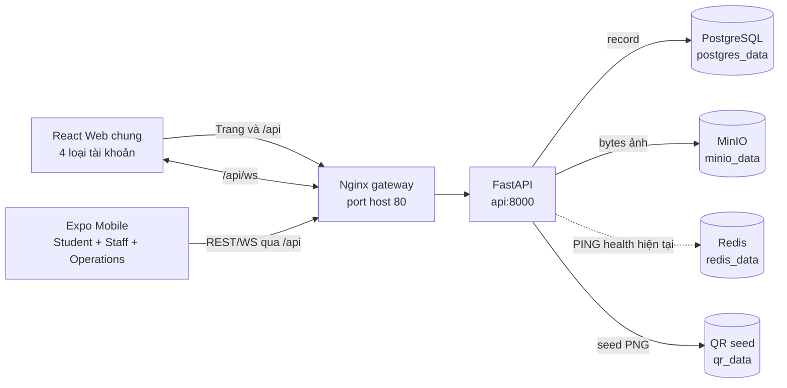
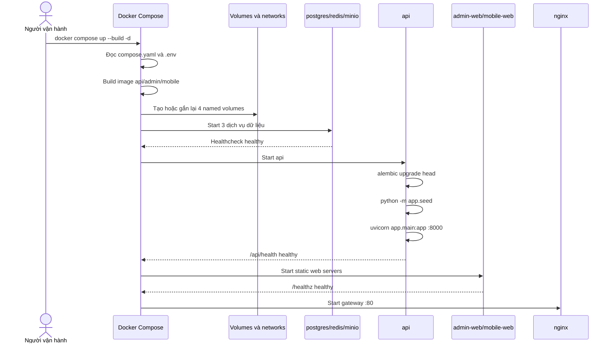
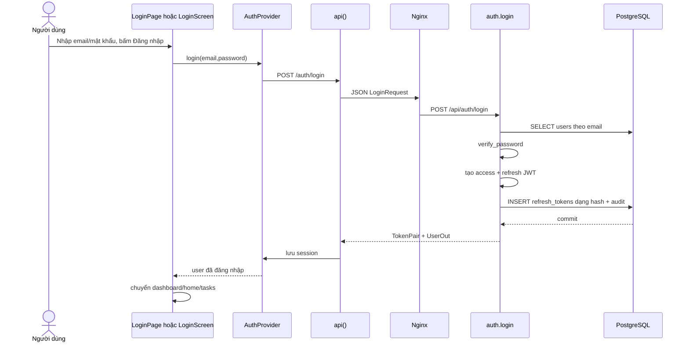
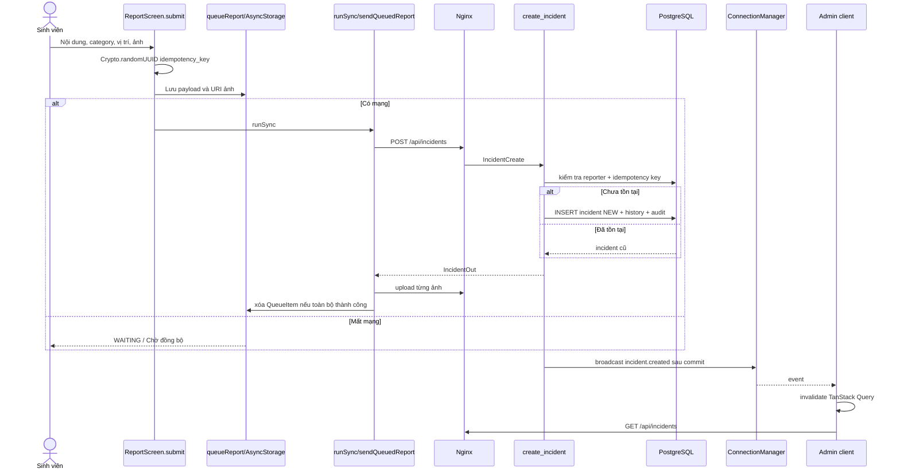
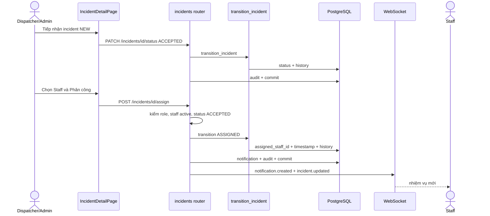
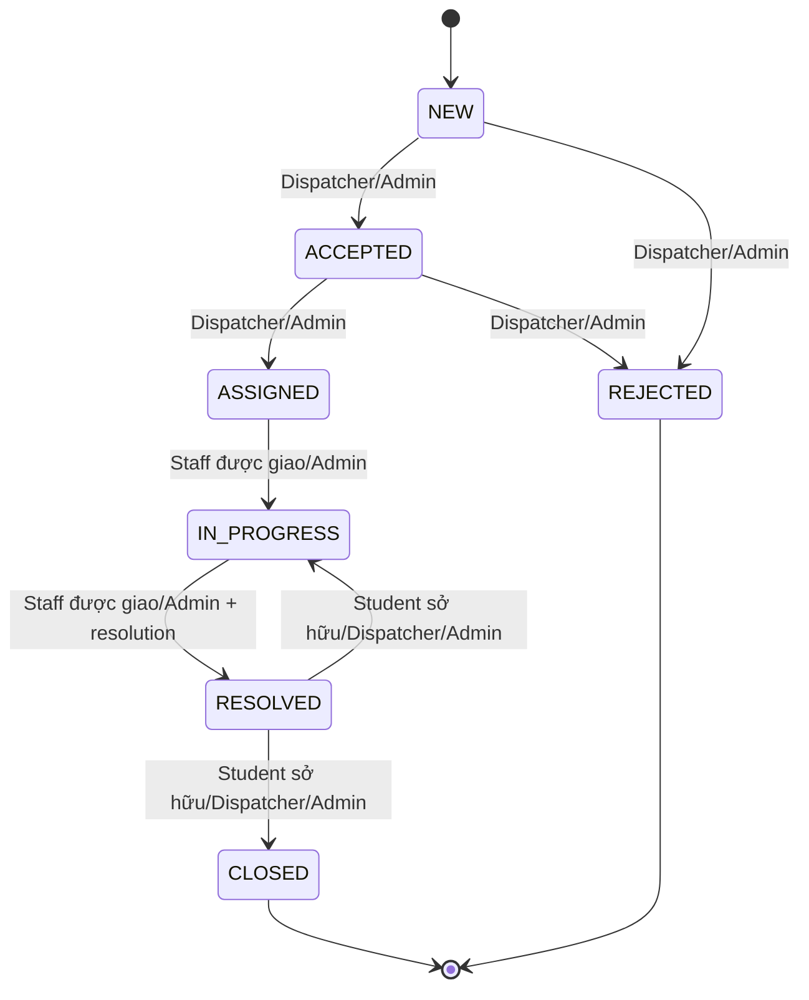
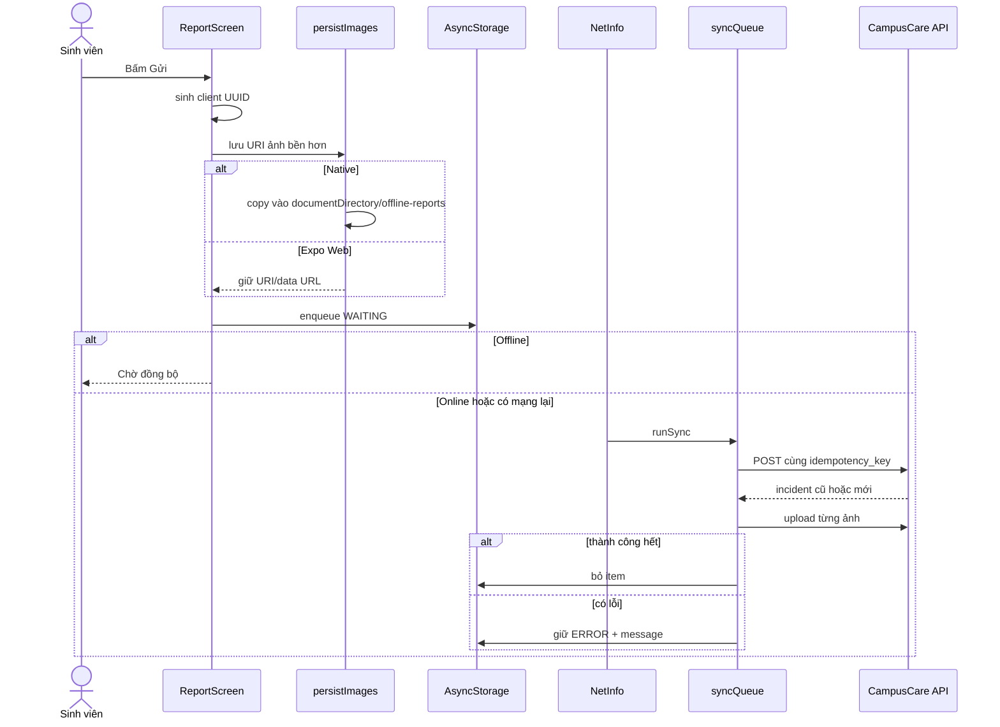
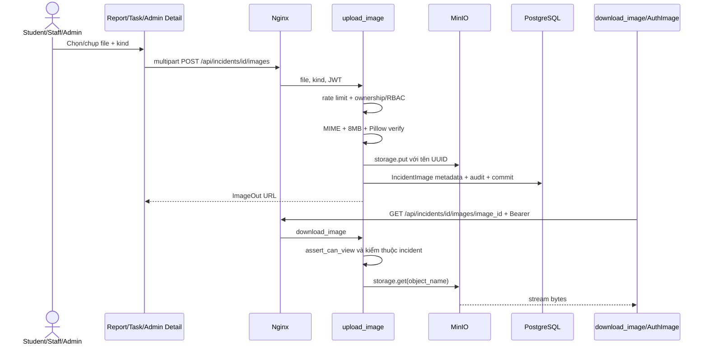

# Luồng hoạt động CampusCare

> Mọi route, file, hàm và bảng trong tài liệu này đã được đối chiếu với mã nguồn
> ngày 24/08/2026. WebSocket chỉ mang tín hiệu cập nhật; REST/PostgreSQL mới là
> nguồn dữ liệu nghiệp vụ. Không có secret hoặc token thật trong tài liệu.

## 1. Kiến trúc tổng thể



## 2. Luồng Docker khởi động



`depends_on.condition: service_healthy` khiến API chờ PostgreSQL/Redis/MinIO và
frontend chờ API. `up --build` gắn lại volume cũ; nó không tự xóa database.

## 3. Luồng đăng nhập



| Bước | File | Hàm/class | Đầu vào | Đầu ra |
|---|---|---|---|---|
| Admin submit | `apps/admin-web/src/pages/LoginPage.tsx` | `LoginPage.submit` | email/password | gọi auth login |
| Mobile submit | `apps/mobile/app/login.tsx` | `LoginScreen.submit` | email/password | gọi auth login |
| Auth web/mobile | `admin/src/auth.tsx`, `mobile/src/AuthContext.tsx` | `AuthProvider.login` | credentials | session + user state |
| HTTP client | `admin/src/api.ts`, `mobile/src/api.ts` | `api` | path/init | JSON hoặc `ApiError` |
| Validation | `services/api/app/schemas.py` | `LoginRequest` | JSON | object hợp lệ/422 |
| Router | `services/api/app/api/auth.py` | `login` | payload/IP/session | TokenPair hoặc 401/429 |
| Password | `services/api/app/security.py` | `verify_password` | password RAM + hash DB | boolean |
| User table | `services/api/app/models.py` | `User` / `users` | email | user record |
| Token | `auth.py`, `security.py` | `_issue_pair`, token functions | user id | JWT + hash row |
| Web session | `admin/src/api.ts` | `saveSession` | TokenPair | localStorage `campuscare_auth` |
| Mobile session | `mobile/src/api.ts` | `saveSession` | Session | AsyncStorage `campuscare:session` |

## 4. Luồng tạo sự cố



| Bước | File | Hàm/class | Đầu vào | Đầu ra |
|---|---|---|---|---|
| Form | `mobile/app/(tabs)/report.tsx` | `ReportScreen.submit` | text/category/priority/location/images | `ReportPayload` |
| Queue runtime | `mobile/src/queueRuntime.ts` | `queueReport`, `persistImages` | payload + URI | QueueItem bền hơn |
| Queue thuần | `mobile/src/offlineQueue.ts` | `enqueue`, `syncQueue` | storage + item | WAITING/ERROR/xóa thành công |
| Sender | `mobile/src/api.ts` | `sendQueuedReport` | QueueItem | incident và upload ảnh |
| Schema | `services/api/app/schemas.py` | `IncidentCreate` | JSON | validated payload |
| Router | `services/api/app/api/incidents.py` | `create_incident` | payload/current user/DB | status 201 + IncidentOut |
| Business helpers | `services/api/app/services.py` | `make_incident_code`, `set_due_at`, `audit` | incident/user/category | code/SLA/audit |
| Models | `services/api/app/models.py` | `Incident`, `IncidentHistory` | fields | rows DB |
| Realtime | `incidents.py`, `realtime.py` | `manager.broadcast` | event JSON | sockets đang online |
| Admin refresh | `admin/components/Layout.tsx` | `socket.onmessage` | event | invalidate query |

## 5. Luồng tiếp nhận và phân công



| Bước | File | Hàm/class | Đầu vào | Đầu ra |
|---|---|---|---|---|
| Nút/selector | `admin/pages/IncidentDetailPage.tsx` | `status`, mutation `/assign` | incident/staff/note | API request |
| Staff list | cùng file | TanStack query | `/users?role=STAFF&active=true` | `User[]` |
| Router | `api/incidents.py` | `assign_incident` | `AssignmentRequest` | IncidentOut |
| Rule | `app/services.py` | `transition_incident` | source/target/actor | history hoặc 403/409 |
| Snapshot assignment | `app/models.py` | `Incident.assigned_staff_id` | Staff UUID | FK `users` |
| Inbox | `services.py` | `add_notification` | user/title/message | row notifications |

Không có bảng `assignments`; người đang được giao nằm ở
`incidents.assigned_staff_id`, còn diễn biến nằm ở `incident_histories`.

## 6. Máy trạng thái thật



Nguồn sự thật là `TRANSITIONS` và `transition_incident` trong `app/services.py`,
không phải các nút frontend.

## 7. Đồng bộ offline



Giới hạn: idempotency chỉ áp cho incident, chưa áp cho từng ảnh. Nếu một số ảnh
đã lên rồi request sau lỗi, retry có thể tải lại ảnh đã thành công.

## 8. Upload và hiển thị ảnh



| Dữ liệu | Nơi lưu | File/class |
|---|---|---|
| Bytes JPEG/PNG/WebP | MinIO volume `minio_data` | `app/storage.py:ObjectStorage` |
| Metadata ảnh | PostgreSQL table `incident_images` | `app/models.py:IncidentImage` |
| Quyền xem | Tính từ incident/current user trước khi đọc MinIO | `download_image`, `assert_can_view` |
| Ảnh offline native | documentDirectory thiết bị | `queueRuntime.ts:persistImages` |
| Queue + URI/data URL | AsyncStorage | `offlineQueue.ts` |
| QR seed | `qr_data`, không phải ảnh sự cố | `app/seed.py` |

Admin component `AuthImage` tải blob bằng Bearer rồi render ``. Mobile Staff
upload được ảnh; màn chi tiết Student hiện chưa render danh sách ảnh.

## 9. Realtime và notification

1. `main.py:websocket_endpoint` đọc access token từ subprotocol, decode và kiểm
   user active trước khi `manager.connect`.
2. Router commit transaction trước rồi `send_user`/`broadcast`.
3. Admin `Layout.tsx` invalidate cache TanStack Query.
4. Mobile `realtime.ts` gọi listener của list/detail.
5. Client đọc lại REST; WS event không thay PostgreSQL.
6. Inbox bền vững nằm trong `notifications`.

`ConnectionManager` nằm trong RAM. Nếu chạy nhiều API replica, cần Redis Pub/Sub;
phần đó chưa có trong code hiện tại.

## 10. Từ URL đến màn hình admin

Ví dụ `http://localhost/incidents`:

1. Gateway `/` → `admin-web:80`.
2. Admin Nginx `try_files ... /index.html` trả SPA shell.
3. `index.html` nạp `src/main.tsx`.
4. `main.tsx` dựng QueryClient, BrowserRouter, AuthProvider, App.
5. `App.tsx` ghép route với `IncidentsPage` qua `Guard` và `Layout`.
6. Page gọi `api('/incidents')`; request quay lại gateway `/api`.
7. FastAPI kiểm JWT/RBAC, đọc PostgreSQL và trả JSON.
8. TanStack Query cập nhật; React render loading/error/empty/table.

## 11. Đường đi của lỗi

```text
Pydantic/HTTPException/backend exception
→ JSON detail + HTTP status
→ Nginx giữ status/body
→ api.ts tạo ApiError
→ query/mutation/try-catch
→ thông báo tiếng Việt trên UI
```

Exception không xử lý được đi qua handler ở `app/main.py`, trả thông báo 500
chung, không gửi stack trace ra frontend. Chi tiết phải đọc log API/Nginx.
